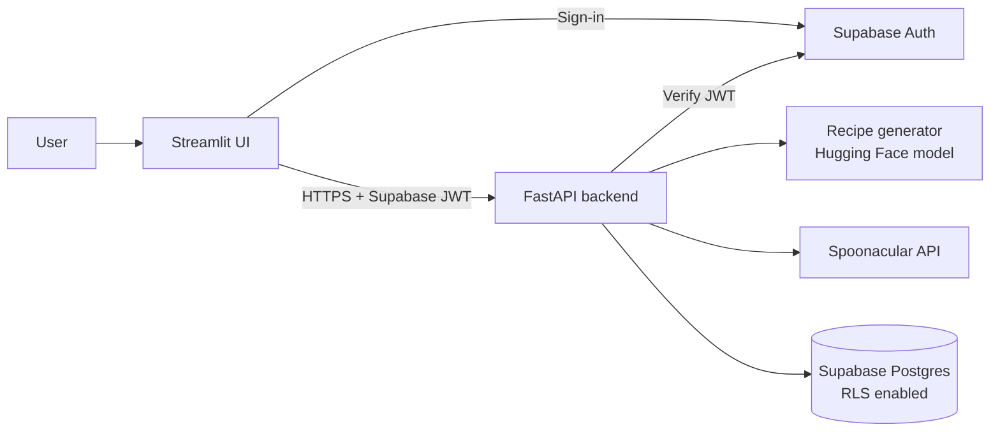

# AI-recipe-generator
# AI-Powered Recipe Generator


Turn the ingredients you already have into practical meal ideas, with nutrition estimates to support more informed choices.

> **Project status: in development.** This README describes the intended design. Items in the [Roadmap](#roadmap) are only ticked once they have been built and tested. Nothing below should be read as a claim that a feature already works unless it is ticked.

## Table of contents

- [Overview](#overview)
- [Features](#features)
- [Tech stack](#tech-stack)
- [Architecture](#architecture)
- [Data model](#data-model)
- [Getting started](#getting-started)
- [Environment variables](#environment-variables)
- [Project structure](#project-structure)
- [API overview](#api-overview)
- [Security and privacy](#security-and-privacy)
- [Testing](#testing)
- [Design decisions](#design-decisions)
- [Known limitations](#known-limitations)
- [Roadmap](#roadmap)
- [Screenshots](#screenshots)
- [Licence](#licence)

## Overview

People often have ingredients at home but struggle to decide what to cook, or to understand the nutritional makeup of what they cook. This project combines two things:

1. **Ingredient-based recipe suggestions** produced by a text-generation model.
2. **Nutrition estimates** sourced from a dedicated nutrition data provider, not from the language model.

Signed-in users can save the recipes they like and come back to them later.

## Features

| Feature | Description |
|---|---|
| Ingredient input | Enter ingredients as chips, with optional quantities and a "pantry staples" toggle. |
| Dietary preferences | Set a diet, allergies, disliked ingredients and a time limit. Exclusions are enforced by validating the output, not only by prompting. |
| Recipe generation | A text model returns a recipe in a strict JSON schema, validated before it is shown. |
| Nutrition analysis | Per-recipe and per-serving estimates from the Spoonacular API. |
| Saved recipes | Save, favourite, search and delete recipes. Stored privately per user. |
| Accounts | Authentication through Supabase Auth. |

## Tech stack

| Layer | Technology | Purpose |
|---|---|---|
| Frontend | [Streamlit](https://streamlit.io/) | Interactive UI |
| Backend | [FastAPI](https://fastapi.tiangolo.com/) | REST API, validation, orchestration |
| Database and auth | [Supabase](https://supabase.com/) | Postgres, Row Level Security, authentication |
| Text generation | [Hugging Face Transformers](https://huggingface.co/docs/transformers/) | Recipe generation (local model or hosted inference, see [Design decisions](#design-decisions)) |
| Nutrition data | [Spoonacular API](https://spoonacular.com/food-api) | Nutrition analysis |
| Validation | Pydantic v2 | Schemas and settings |
| Tooling | pytest, Ruff, GitHub Actions | Tests, linting, CI |

## Architecture



The frontend never holds privileged keys. The backend verifies the user's Supabase JWT on every protected route and is the only component that calls the text model and Spoonacular.

## Data model

Planned tables (all with Row Level Security so users can only access their own rows):

- `profiles`: user profile data.
- `dietary_preferences`: diet, allergies, exclusions, cuisines.
- `recipes`: title, servings, ingredients (JSON), steps (JSON), nutrition (JSON), model name, favourite flag.
- `recipe_generations`: log of generation requests (ingredients, latency, success flag).
- `nutrition_cache`: cached nutrition results keyed by a normalised ingredient list, to protect API quota.

Schema changes are managed as migrations in `supabase/migrations/`.

## Getting started

> The commands below describe the intended workflow. Confirm them against the final repository layout and update this section when the build is complete.

### Prerequisites

- Python 3.11 or newer
- [Supabase CLI](https://supabase.com/docs/guides/cli)
- A Supabase project (free tier is enough)
- A Spoonacular API key (free tier available, quota is limited)
- Git

### 1. Clone

```bash
git clone https://github.com/mojalefa100/ai-recipe-generator.git
cd ai-recipe-generator
```

### 2. Create a virtual environment and install dependencies

```bash
python -m venv .venv
source .venv/bin/activate        # Windows: .venv\Scripts\activate
pip install -r backend/requirements.txt
pip install -r frontend/requirements.txt
```

### 3. Configure environment variables

```bash
cp .env.example .env
```

Fill in the values described in [Environment variables](#environment-variables). Never commit `.env`.

### 4. Set up the database

```bash
supabase link --project-ref <your-project-ref>
supabase db push
```

### 5. Run the backend

```bash
uvicorn backend.app.main:app --reload --port 8000
```

API docs will be available at `http://localhost:8000/docs`.

### 6. Run the frontend

```bash
streamlit run frontend/app.py
```

## Environment variables

| Variable | Used by | Description |
|---|---|---|
| `SUPABASE_URL` | Backend, frontend | Your Supabase project URL. |
| `SUPABASE_ANON_KEY` | Frontend | Public anon key. Safe for the client because RLS protects the data. |
| `SUPABASE_SERVICE_ROLE_KEY` | Backend only | Privileged key. Never expose it to the client or commit it. |
| `SUPABASE_JWT_SECRET` | Backend | Used to verify user tokens (or use the project's JWKS, per the Supabase docs). |
| `SPOONACULAR_API_KEY` | Backend only | Nutrition provider key. |
| `HF_API_TOKEN` | Backend | Only needed if using hosted inference. |
| `HF_MODEL_ID` | Backend | Model identifier to load or call. |
| `FRONTEND_ORIGIN` | Backend | Allowed CORS origin, for example `http://localhost:8501`. |
| `API_BASE_URL` | Frontend | Where the backend is running. |

An `.env.example` with placeholders is included in the repository.

## Project structure

Proposed layout (will be updated to match the final repository):

```
.
├── backend/
│   ├── app/
│   │   ├── main.py
│   │   ├── routers/
│   │   ├── services/        # generation, nutrition, recipes
│   │   ├── repositories/    # database access
│   │   ├── schemas/         # Pydantic models
│   │   └── core/            # config, auth, logging
│   ├── tests/
│   └── requirements.txt
├── frontend/
│   ├── app.py
│   ├── components/
│   └── requirements.txt
├── supabase/
│   └── migrations/
├── docs/                    # architecture decision records
├── .env.example
└── README.md
```

## API overview

Planned endpoints (final contract documented in the generated OpenAPI docs):

| Method | Path | Description |
|---|---|---|
| `GET` | `/health` | Health check. |
| `POST` | `/recipes/generate` | Generate a recipe from ingredients and preferences. |
| `POST` | `/recipes/nutrition` | Get nutrition estimates for a recipe. |
| `GET` | `/recipes` | List the current user's saved recipes. |
| `POST` | `/recipes` | Save a recipe. |
| `GET` | `/recipes/{id}` | Get one saved recipe. |
| `DELETE` | `/recipes/{id}` | Delete a saved recipe. |

All routes except `/health` require a valid Supabase JWT.

## Security and privacy

- Row Level Security is enabled on every table.
- The service-role key and the Spoonacular key stay on the backend.
- CORS is restricted to the configured frontend origin.
- Model output is treated as untrusted: it is schema-validated and escaped before rendering.
- Expensive endpoints are rate limited.
- Only the data needed to run the app is stored, and users can delete their saved recipes.

## Testing

```bash
pytest
ruff check .
```

Planned coverage: recipe schema validation and bounded retry on malformed output, enforcement of excluded ingredients, nutrition caching and graceful failure, authorisation (user A cannot read user B's recipes), and one end-to-end happy path with external services mocked.

## Design decisions

Recorded as short architecture decision records in `docs/`.

- **Nutrition comes from Spoonacular, never from the language model.** Language models invent plausible numbers. If the nutrition provider is unavailable, the app shows the recipe without nutrition and says why.
- **Model hosting is an open decision.** Running a Transformers model locally is heavy on CPU and slow. A small instruction-tuned model run locally and a hosted inference option will be compared on latency and memory before one is chosen. The generator sits behind an interface so it can be swapped.
- **Streamlit with a separate FastAPI backend.** These are often alternatives. Here the split is deliberate: Streamlit handles the interface and FastAPI keeps secrets, validation and third-party calls on the server.
- **Authentication in Streamlit needs care.** OAuth redirects reset Streamlit's session state, so the sign-in flow is proven in an isolated spike before features are built on top of it.

## Known limitations

- Generated recipes are untested suggestions and may be unsafe or impractical.
- Nutrition values are estimates and depend on how ingredients are parsed.
- This tool is not medical or dietary advice. People with allergies must check ingredients themselves.
- The free Spoonacular tier has a limited daily quota.

## Roadmap

- [ ] Define the initial feature scope
- [ ] Authentication spike (sign-in round trip in Streamlit)
- [ ] Database schema, migrations and RLS policies
- [ ] Ingredient input and preferences UI
- [ ] Recipe generation with schema validation
- [ ] Nutrition integration with caching
- [ ] Save, favourite and search recipes
- [ ] Error handling, loading and empty states
- [ ] Automated tests and CI
- [ ] Responsive and accessibility review
- [ ] Deployment

## Screenshots

Screenshots will be added once the interface is working.

## Licence

To be decided.

## Author

Mojalefa Moletsane ([GitHub](https://github.com/mojalefa100) · [LinkedIn](https://www.linkedin.com/in/mojalefa-moletsane-3bb034150))